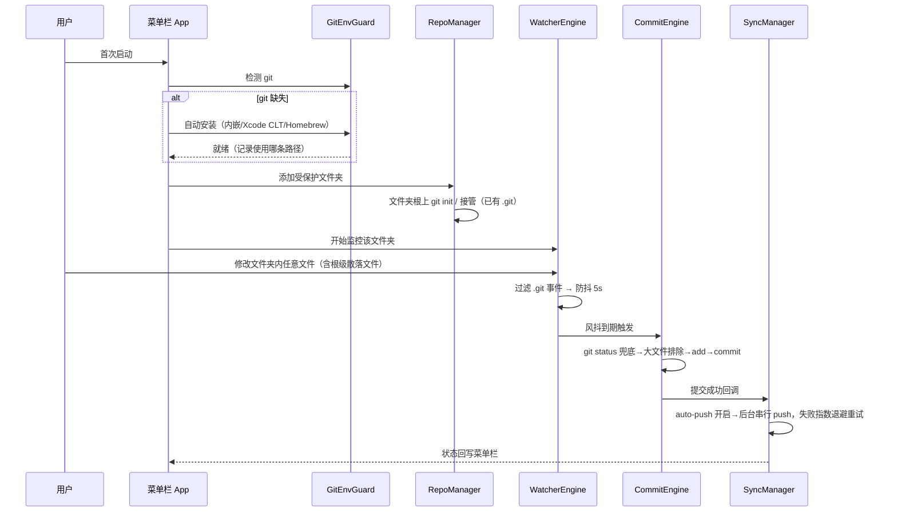

# FileVault 技术架构方案

版本：v1.0 · 日期：2026-11-14

## 1. 技术选型

| 方案 | 内存占用 | 菜单栏 | 文件监控 | git 集成 | 结论 |
|---|---|---|---|---|---|
| **Swift 原生（Swift 6, 语言模式 5）** | <80MB | NSStatusItem 原生 | FSEvents 原生 | git CLI | **选定** |
| Tauri (Rust + Web) | ~30MB | 需原生桥接 | 需 notify crate | git2 binding | 备选 |
| Electron | 200MB+ | 需原生桥接 | chokidar | dumb CLI 调用 | 弃用 |

**技术组合**：Swift 6.4（语言模式 5）+ AppKit（NSStatusItem 菜单栏）+ FSEventStream + git CLI（系统 git 优先，缺失时内嵌 git 兜底）。

选 git CLI 而非 libgit2 的理由：gc、credential helper（osxkeychain）、与用户终端完全互通；内嵌静态 git 二进制（做法同 GitHub Desktop）解决「用户机器没有 git」的问题。libgit2 作为备选架构保留。

## 2. 总体架构

```
┌─────────────────────────────────────────────┐
│              FileVaultApp（可执行）            │
│  菜单栏 + 设置 + 历史窗口 + 恢复窗口（v4.1）    │
│         --smoke 自检 · --help 用法            │
└──────────────────┬──────────────────────────┘
                   │ 状态订阅
┌──────────────────▼──────────────────────────┐
│               FileVaultCore                  │
│  GitEnvGuard · RootManager · RepoManager     │
│  WatcherEngine(FSEvents) · Debouncer         │
│  CommitEngine · SyncManager · HistoryService │
│  RecoveryService（文件恢复索引/版本/恢复）      │
│  ConfigStore · GitRunner · PauseController   │
└─────────────────────────────────────────────┘
```

## 3. 模块职责

| 模块 | 职责 | 关键点 |
|---|---|---|
| GitEnvGuard | git 检测与自动安装 | 候选路径探测（内嵌/已下载/系统）+ `git --version` 验证；策略链：内嵌 git → 多镜像下载（sha256 锁定）→ Xcode CLT 兜底；状态机：未检测→检测中→就绪/失败 |
| GitProvisioner | 自包含 git 的下载与安装 | 镜像阶梯（GitHub/加速器/自建，见 `docs/07`）+ 大小/sha256 校验 + tar 解包 + `git --version` 冒烟 + `GIT_EXEC_PATH` 等环境变量推导 |
| RootManager | 受管根目录注册表 | 添加/移除根目录；配置持久化（JSON） |
| RepoManager | 受管文件夹 → 一个仓库 | v4.0：仓库就在文件夹根上；根级散落文件/多级子文件夹/隐藏目录（除 .git 与忽略规则）全部纳入；已有 .git 原样接管；注入 .gitignore 模板；大文件写入 .git/info/exclude |
| WatcherEngine | FSEvents 流 + .git 过滤 | kFSEventStreamCreateFlagFileEvents；整个文件夹任意事件归一为一个防抖键，忽略任意层级 .git 内部事件 |
| Debouncer | 静默 5s 才触发，最大等待 60s | 激活重置计时器，防提交风暴 |
| CommitEngine | 检查 dirty→大文件保护→add→commit | git status --porcelain 兜底自愈；提交信息生成 |
| SyncManager | 远程配置、auto-push 队列、重试 | remote 写 .git/config；后台串行队列；指数退避；状态机：noRemote/synced/pendingPush/pushing/failed |
| HistoryService | 历史浏览/预览/导出 | log 解析、片段 diff、blame、标签与备份 ref；整仓 reset --hard（需确认；仅本地当前分支，不回写远程；忽略/大文件/嵌套仓库不受影响） |
| RecoveryService | 文件恢复（v4.1） | 文件夹扫描（HEAD 树 + 历史删除）、单文件版本时间线、单文件恢复（先 cat-file 校验目标版本，再备份未提交改动 → checkout 单路径 → 提交 `restore:`）；恢复结果区分「已恢复/已是该版本」；与历史窗口共用 |
| ConfigStore | JSON 配置持久化 | ~/Library/Application Support/FileVault/config.json |
| GitRunner | git 进程执行封装 | 注入 PATH 含 git 所在目录；超时；输出捕获 |
| PauseController | 每根目录暂停（v4.2.22 移除全局暂停） | 恢复时触发该 root 的脏检查 |

## 3.5 协议抽象

核心服务面向协议：`GitLocator`、`GitInstaller`、`ChangeSource`（FSEvents 实现为主）、`Clocking`（测试可控时间）。测试用 fake/桩替换，不依赖真实网络与系统状态。

## 3.6 状态机

- **GitEnvGuard**：未检测 → 检测中 → 就绪（复用/内嵌）/ 失败（可重试）
- **SyncManager 每受保护文件夹（= 一个仓库）**：noRemote → synced → pendingPush → pushing → synced / failed →（重试）→ pushing
- 本地提交永远先行：push 失败仅标记 failed + 重试，不回滚本地提交

## 4. 关键流程（时序）



## 5. 关键设计决策

1. **整个文件夹一个仓库（v4.0）**：受管文件夹本身就是一个仓库；根级散落文件、多级子文件夹、隐藏目录（除 .git 与忽略规则）全部纳入；文件夹已有 .git 原样接管。v3.x 的「第一层子文件夹各自成仓」已移除：它让根级散落文件不受保护、每加一个子文件夹就多一个要单独配远程的仓库，且跨文件夹移动文件会割裂历史。
2. **git status 兜底自愈**：防抖到期后先 `git status --porcelain`，有变更才提交——错过的事件在下次触发时自愈。
3. **大文件走 `.git/info/exclude`**：不污染用户 .gitignore；阈值跟随远端（github.com → 100MB，其他远端不设限）。
4. **remote 与终端互通**：remote URL 写入仓库自身 .git/config（标准 remote.origin.url），用户在终端 push/pull 完全兼容。auto-push 开关存 git 本地配置 `filevault.autopush`。
5. **认证**：SSH 复用 ~/.ssh + ssh-agent；HTTPS 走 credential helper（优先 osxkeychain 钥匙串；机器上没有助手时退化为仅本人可读的 0600 本机文件）。凭证只进凭证库，从不写进 git 配置；「用户名 + 访问令牌」在选择该模式后于设置卡片内两个输入框录入，点保存即刻入库（v4.0.2 修复：此前该模式既没有输入框、选择也从未落盘）。
6. **防抖参数**：默认静默 5s / 最大等待 60s，均可配置；测试可用 0.2s 快速验证。
7. **gc**：每周自动 `git gc --auto`；仓库 > 2GB 告警（P1 实现）。
8. **权限**：NSOpenPanel + 安全作用域书签；本 MVP 为非沙盒应用，直接可用。

## 5.5 关键设计决策（远程同步）

1. commit → 开启 auto-push → 后台串行队列 push，失败指数退避（1s/2s/4s…上限 5min），网络恢复自动补推。
2. 统一 main 分支；上游有新提交时拉取：能快进就快进，两边都有提交时自动变基（本地未推送的自动提交重放到远程之上，保持线性历史）；冲突自动中止 rebase 并恢复；自动推送若被拒（远程已有新提交），push 循环先调用同一套拉取/变基逻辑再重试一次，若仍遇冲突/历史无关则回退到无损合并（mergeSync）再推，冲突标记永不进入提交；分支保护等确定性失败只通知一次并停止重试（不强推）。pull/sync/force-pull 通过文件夹级异步互斥锁串行，避免并发 rebase。破坏性操作（pull 快进/变基、force pull reset、sync merge）前先 fetch 并用 diff --name-only 求出远程将要写入的路径，与 ls-files --others --ignored 求交集，把会被静默覆盖的忽略文件移动为「本地副本」；大文件排除通过 CommitEngine → FileVaultService.onLargeFilesExcluded 通知一次（规则写入后文件即被忽略，后续不再重复触发），RepoManager.excludedLargeFiles 解析 .git/info/exclude 的 marker 段，RepoHealth.excludedLargeFileCount 汇总到设置页健康文本；relocateRoot(from:to:) 先停旧 WatcherEngine、unregisterRoot 与解除 pause，再 attachRoot 新路径（ensureRepo 会接管随文件夹移动的 .git），最后把 ManagedRoot.path 改为新路径并保留 paused（目标重复时抛 rootAlreadyManaged，状态不变）；RecordsWindow 用 AppState.recordsTab 驱动分段控件，RecoveryView 与 HistoryView 以 ZStack(opacity/hitTesting/accessibilityHidden) 常驻以保留选择；Window scene 由 history/recovery 两个改为单个 records；RepoAuthSection 把认证 Picker 与 RepoAuthFields 收进默认折叠的 DisclosureGroup（auto 模式收起，pat/ssh 模式自动展开）；QuickAddSheet（App）走 AppState.quickAddRequested + DashboardView.sheet：选文件夹（NSOpenPanel）→ 可选远程地址（已有 origin 时经 RepoManager.remoteURL 预填）→ FileVaultService.addRoot + SyncManager.configureRemote；首启 onboarding 改为打开主面板并自动弹出该窗口；SyncManager.syncWithRemote 先 pull（ff 或自动变基），遇 mergeConflict/unrelatedHistories 回退 mergeSync，随后 enqueuePush 推送本地领先提交；FileVaultService.sweepOnce 按 remoteSyncInterval（默认 300s，启动首轮立即到期）对未暂停且配置了远程的 root 调用它；restoreDirectory 删除“目标版本里不存在”的文件夹前，用 ls-files --others（含 --ignored）扫描未纳管文件，非空则抛 rollbackWouldDeleteUntracked 拒绝执行；FileVaultService.start 在挂载完 roots 后异步执行一次 sweepOnce（启动补交，提交上次退出前未落盘的改动），之后每 120 秒周期执行；restoreFile 先用 cat-file -t 校验目标版本该路径是 blob，并检查工作区目标路径不是目录（是则抛 restoreTargetIsDirectory，绝不覆盖），checkout 会自动重建缺失父目录；CloudFolderAdvice.provider(for:) 按路径识别 iCloud/Dropbox/OneDrive/Google Drive 并在设置页健康文本提示；deterministicPushRejection 增加只读/归档/无写权限模式；ConfigStore 采用主文件 + config.backup.json 双份：保存前备份上一份可解码配置（主文件损坏则移存 config.corrupt-*.json），加载失败时回退备份并记录 lastLoadIssue，由 FileVaultService 启动时通知；RepoManager.buildCommitMessage 通过 subjectLabel 清洗显示名（控制字符→空格、60 字符截断）；RepoManager.status 用 porcelain -z（重命名时下一条记录为原始路径）、listFiles 用 ls-files -z、unmergedPaths 用 diff --name-only -z、treeDiffCounts 用 ls-tree/diff --name-status 的 -z 形式，避免特殊文件名被 C 引号或换行破坏；attachRoot 在 ensureRepo 后用 acquireInstanceLock 写 .git/filevault-instance.pid 并检查持有者 （kill(pid,0) 判活，EPERM 视为存活），foreignInstancePID 供 UI 显示；removeRoot/relocateRoot 释放自己的锁，sweepOnce 重试启动时未挂载的 root 从而在对方退出后接管；RepoManager.health 先用 isRepo 判断可用性，不可用直接返回 available=false 的健康快照；FileVaultService.attachRoot 新增 announceReinitialisation（仅启动时 true），在 ensureRepo 前记录 .git 是否存在与文件夹是否非空，重新初始化后据此发通知；WatcherEngine 暴露 isRunning，sweepOnce 对已存在但监听停止/缺失的 root 重新 startWatching 或 attachRoot；SyncManager.pushOnce 捕获 -9 超时后用 longPushTimeout（默认 5×120 秒）重试一次；FileVaultService 启动后每 120 秒执行一次 sweepOnce：对未暂停 root 调 status，脏则直接 runCommitPipeline（绕过防抖），作为 FSEvents 漏事件的兜底，不改变事件驱动的正常路径；GitRunner 统一注入 GIT_TERMINAL_PROMPT=0 与 GIT_SSH_COMMAND=ssh -o BatchMode=yes -o ConnectTimeout=20（调用方 env 或 core.sshCommand 可覆盖），避免后台同步等待不可见提示；SyncManager 用 failureStreakNotified 集合做推送失败通知节流：首次失败通知、重试静默、达到 maxAttempts 时再发「已自动重试 N 次」并停止；pushWithReconcile 在 pull 抛 mergeConflict/unrelatedHistories 时回退到 mergeSync（保留双方文件）再重推；CommitEngine 在自动提交失败后按仓库计数（成功或新文件活动清零），首失败通知一次、后台每 60 秒重试，最多 3 次后提示放弃，失败原因按磁盘/权限/锁文件/dubious ownership 归类；GitRunner 为每条命令加命令级 -c safe.directory=<工作目录>，使受保护文件夹即使属于其他账户/外置盘也能正常读写（不改用户全局配置），dubious ownership 仍归类为 unsafeRepository 作为兜底；多个远程时 setUpstreamRemote 直接写 branch.<分支>.remote/merge（不要求远端分支已存在），供自动同步选择远程；多远程时 ambiguousRemote 携带远程名列表；repairInterruptedOperation 也会删除超过 5 分钟的 .git/index.lock（新锁不动，避免破坏进行中的 git 进程）。崩溃残留的 rebase-merge/MERGE_HEAD 通过 repairInterruptedOperation（rebase --abort / merge --abort，持文件夹锁）清理。网络命令（fetch/pull/push）使用 120 秒超时并把超时映射为 networkFailed；setRemote 补 remote.origin.fetch 默认 refspec；分支缺失错误附带远程实际分支列表；push 的确定性拒绝（分支保护/GH006/GH013、pre-receive hook、文件过大）只通知一次并停止退避重试；index.lock 归类为 repositoryLocked 并给出清理指引。更换远程时 setRemote 检测 URL 变化：解除 upstream、删除 refs/remotes/origin/*、fetch --prune 新远程并统计其当前分支提交数；若新远程已有提交则写入 git 配置 filevault.remoteswitchpending=true，enqueuePush 见该标记只置 pendingPush 不推送，pull/sync/force-pull/pushNow 显式成功后清除标记，避免两套历史被自动合并。历史互不相关/同名冲突在 v4.2 由自动兜底处理：pushWithReconcile 捕获 mergeConflict/unrelatedHistories 后调用 mergeSync（git merge --no-commit --allow-unrelated-histories，冲突路径保留本地版本到原名、远程版本用 checkout-index --stage=3 另存为「名称 (远程副本)」，再提交合并），随后重试推送；v4.2 界面不再提供「同步远程文件到本地 / 强制拉取」手动入口（forcePull 实现保留用于测试与内部兜底）。冲突标记永不进入自动提交（合并期间提交管线暂停；同一文件夹的远程操作有重入锁）。
3. 首次配置远程的检查清单：远程已创建、认证可用、无敏感文件提醒。
4. 菜单栏每文件夹状态：✓ 已同步 / ↑N 待推送 / ⚠ 失败 / 无远程=仅本地。

## 6. 测试策略

- **单元/集成测试（XCTest）覆盖全部核心功能**：
  - GitRunner：真实 git 执行端到端
  - GitEnvGuard：真实探测 + fake locator 安装策略
  - ConfigStore：JSON 往返持久化
  - RepoManager：init/接管/跳过隐藏目录/gitignore 注入
  - Debouncer：尾随触发/最大等待上限
  - WatcherEngine：真实 FSEvents 集成测试
  - CommitEngine：变更→自动提交、防抖合并、删除提交、暂停恢复、提交信息格式、大文件保护
  - SyncManager：本地裸仓作远程（file 路径）：配置/auto-push/失败重试/状态机
  - HistoryService：log 解析/预览/整仓回滚
  - RecoveryService：已删除索引、最近修改索引、版本时间线、恢复事务与「无需恢复」判定
- 测试不依赖真实网络：远程用本地裸仓作 remote。
- UI 不做自动化，`--smoke` 自检（core 初始化 + 配置读写 + git 检测）+ 真人验收。
